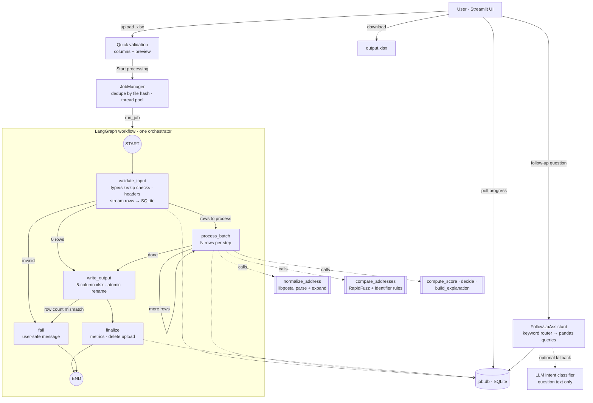

# Address Normalization & Matching POC

Upload an `.xlsx` with **AddressA** and **AddressB**; a background LangGraph workflow normalizes both
addresses with **libpostal**, compares them component by component, and returns a downloadable
workbook with exactly five columns: `AddressA, AddressB, normalized_AddressA, normalized_AddressB, Result`.
A follow-up chat answers questions about the finished job from its stored results.

## Architecture summary and key design choices

- **One orchestrator, deterministic tools.** A single LangGraph `StateGraph` runs the job. Every node calls
  plain, unit-tested Python: workbook validation, libpostal normalization, component comparison,
  scoring, rule-based decisions, explanation text, Excel I/O. **No LLM touches normalization, scoring or decisions.**
- **Contradictions beat scores.** A conflicting building number, unit, street, PO box or country forces NON-MATCH
  regardless of the aggregate score. Missing components are *unknown*, never mismatches. MATCH requires matched
  street + house number/building name + a location component (postcode/city/locality).
- **Everything tunable lives in `config/scoring.toml`**: weights, similarity cut-offs, thresholds, required
  evidence groups, and the action per contradiction (`non_match` / `review` / `score_only`).
  All defaults are **starting values**; the score is a weighted similarity, **not a probability**.
- **Explanations are generated from the comparison objects**, so they can only state computed evidence.
- **Background work without extra infrastructure**: an in-process thread pool plus one SQLite file per job
  (input rows, results, progress). Batches are read from SQLite, so the workbook is streamed once, not held in memory.
- **LLM is optional** and only used to map an unrecognised follow-up question onto one of the supported,
  deterministic queries. It receives the question text only — never addresses.

---

## A. Architecture and workflow



**Per-row pipeline** (`matcher.py`):

1. `normalize_address` (×2, independently): empty → `EMPTY`; libpostal `parse_address` → labelled
   components; each component expanded with `expand_address` restricted to that component's dictionaries
   (street types for roads, unit designators for units, toponyms for places). Failures return `FAILED` with a reason.
2. `compare_addresses`: house number / PO box as identifiers (`12` ≠ `21`, `12` vs `12A` flagged), units by
   identifier tokens (`Apt #4-B` = `Apartment 4B`), postcodes canonicalised (`NW1 6XE` = `NW16XE`,
   ZIP = ZIP+4), free text with RapidFuzz `token_sort_ratio`/`ratio` over all libpostal expansions;
   numbered streets (`5th` vs `6th Ave`) conflict; a city found under another area label on the other side counts.
3. `compute_score`: weighted mean similarity over components present on **both** sides → 0–100.
4. `decide`: rules in this order — no overlap → REVIEW; `non_match` contradiction → NON-MATCH;
   `review` contradiction → REVIEW; score ≥ match threshold + coverage + required evidence + no one-sided
   house number/unit → MATCH; score < non-match threshold with coverage → NON-MATCH; else REVIEW.
5. `build_explanation` → `DECISION | Score: NN/100 | explanation.`

**Tool boundaries**

| Layer | Module | Deterministic | Notes |
|---|---|---|---|
| Orchestration | `workflow.py` | yes | LangGraph nodes + routing only |
| Normalization | `normalization.py`, `components.py` | yes | libpostal wrapper, label mapping, canonicalisers |
| Comparison / scoring / decision / text | `comparison.py`, `scoring.py`, `decision.py`, `explanation.py` | yes | pure functions |
| Excel I/O | `excel_io.py` | yes | streaming read, formula-safe write |
| Persistence / jobs | `job_store.py`, `jobs.py` | yes | SQLite per job, thread pool |
| Follow-up chat | `chat.py` (+ optional `llm.py`) | answers yes; LLM only routes | |
| UI | `app/streamlit_app.py` | — | |

## B. Directory structure

```
address_matcher_poc/
├── app/streamlit_app.py          # UI: upload, progress, summary, preview, download, chat
├── config/scoring.toml           # weights, thresholds, rules, contradiction actions
├── data/sample/
│   ├── sample_input.xlsx         # 22 SYNTHETIC rows with TrueLabel/Note columns
│   └── expected_output.xlsx      # produced by the real pipeline (libpostal)
├── scripts/
│   ├── install_libpostal.sh      # native lib + data + Python binding (Debian/Ubuntu)
│   ├── create_sample_data.py     # regenerates the sample workbook
│   ├── run_batch.py              # run a workbook through the workflow without the UI
│   └── evaluate.py               # precision/recall/false-match/review rate + threshold sweep
├── src/addrmatch/
│   ├── settings.py               # env-var settings
│   ├── scoring_config.py         # loads/validates scoring.toml
│   ├── normalization.py          # libpostal backend, normalize_address, caching
│   ├── components.py             # label→field map, canonicalisers
│   ├── comparison.py             # component comparisons (RapidFuzz + rules)
│   ├── scoring.py                # weighted 0–100 score + coverage
│   ├── decision.py               # MATCH / NON-MATCH / REVIEW rules
│   ├── explanation.py            # evidence-based Result text
│   ├── matcher.py                # per-row pipeline
│   ├── excel_io.py               # safe xlsx read/write
│   ├── job_store.py              # SQLite per job
│   ├── jobs.py                   # background JobManager (dedupe, retry, retention)
│   ├── workflow.py               # LangGraph graph
│   ├── chat.py                   # follow-up question router + handlers
│   └── llm.py                    # optional OpenAI-compatible intent classifier
├── tests/                        # unit, integration (real libpostal), workflow, chat, UI smoke
├── .env.example  Dockerfile  pyproject.toml  requirements.txt  requirements-dev.txt
```

## C. Installation and configuration

Requirements: **Python 3.11+** (tested on 3.13.16), ~3 GB disk and ~2.5 GB RAM for libpostal's model.

### 1. libpostal (native library + data) — required

`pip install postal` alone is **not** enough: the binding compiles against the C library and needs the ~2 GB model data.

**Linux (Debian/Ubuntu) — tested here**

```bash
sudo ./scripts/install_libpostal.sh /opt/libpostal_data
```

It does the following (also fine to run by hand):

```bash
sudo apt-get install -y build-essential curl git autoconf automake libtool pkg-config python3-dev
git clone https://github.com/openvenues/libpostal && cd libpostal
./bootstrap.sh
./configure --datadir=/opt/libpostal_data      # add --disable-sse2 on ARM (Apple Silicon, Graviton)
make -j"$(nproc)"                              # also downloads the model data
sudo make install && sudo ldconfig
pip install --use-pep517 postal                # --use-pep517 avoids a Debian setuptools "install_layout" error
```

Verified in this build environment: libpostal commit `25099c5` (2025-12-06), data `v1`, `postal` 1.1.11.

**macOS — not tested here.** Install build tools (`brew install curl autoconf automake libtool pkg-config`),
then follow the same source build; on Apple Silicon add `--disable-sse2` to `./configure`. Homebrew may also
offer a `libpostal` formula; if you use it, point the binding at Homebrew's prefix
(`CFLAGS=-I$(brew --prefix)/include LDFLAGS=-L$(brew --prefix)/lib pip install --use-pep517 postal`).

**Windows — not supported natively.** Use WSL2 (Ubuntu, then the Linux steps) or the Dockerfile.

**Docker** — `docker build -t addrmatch . && docker run -p 8501:8501 addrmatch`. The Dockerfile mirrors the
tested script but was **not built** in the authoring environment (Docker was unavailable there).

### 2. Python packages

```bash
python3 -m venv .venv && source .venv/bin/activate
pip install -r requirements-dev.txt          # includes postal; install libpostal first
cp .env.example .env                          # adjust limits, data dir, optional LLM
```

### 3. Configuration

- `.env` — runtime settings (data dir, upload/row limits, batch size, retention, optional LLM). See `.env.example`.
- `config/scoring.toml` — matching behaviour. Changing it changes the job fingerprint, so a re-upload is
  processed again rather than reusing old results.

## D. Source code

All source is in the files listed in section B; every module has a docstring describing its responsibility.
Start with `src/addrmatch/workflow.py` (the graph) and `src/addrmatch/matcher.py` (the per-row pipeline).

## E. Sample input / output

`data/sample/sample_input.xlsx` contains 22 **synthetic** pairs (invented addresses) with extra `TrueLabel`
and `Note` columns that the app ignores. `data/sample/expected_output.xlsx` is the real output of the
pipeline with libpostal and the default config. Selected rows:

| AddressA | AddressB | Result |
|---|---|---|
| 12 Main Street, Springfield, IL 62701 | 12 main st., springfield il 62701 | MATCH \| Score: 100/100 \| Building number, street, postal code, city and state/region match; differences are formatting/abbreviation only. |
| 12 Main St, Springfield, IL 62701 | 21 Main St, Springfield, IL 62701 | NON-MATCH \| Score: 67/100 \| Building number differs: 12 vs 21; street, postal code, city and state/region match. |
| 12 Main St Apt 4B, … | 12 Main St Apt 5C, … | NON-MATCH \| Score: 88/100 \| Unit differs: apt 4b vs apt 5c; building number, street, postal code, city and state/region match. |
| 12 Main St, Springfield, IL 62701 | 12 Main St, Springfield, IL 62704 | REVIEW \| Score: 80/100 \| Postal code differs: 62701 vs 62704; building number, street, city and state/region match. |
| 12 Main St, Springfield, IL | Main St, Springfield, IL | REVIEW \| Score: 100/100 \| Building number missing from AddressB; street, city and state/region match. |
| 350 5th Ave, New York, NY 10118 | 350 Fifth Avenue, New York, NY 10118 | MATCH \| Score: 100/100 \| …; differences are formatting/abbreviation only. |
| 350 5th Ave, New York, NY 10118 | 350 6th Ave, New York, NY 10118 | NON-MATCH \| Score: 87/100 \| Street differs: 5th avenue vs 6th avenue (numbers in street name differ); … |
| Flat 4B, 12 M.G. Road, Indiranagar, Bengaluru 560038 | Flat 4B, 12 MG Rd, Indiranagar, Bangalore 560038 | REVIEW \| Score: 96/100 \| City differs: bengaluru vs bangalore; building number, street, unit, postal code and locality match. |
| Hauptstraße 5, 10115 Berlin | Hauptstr. 5, 10115 Berlin, Germany | MATCH \| Score: 100/100 \| Building number, street, postal code and city match. |
| *(empty)* | 12 Main St, Springfield, IL 62701 | REVIEW \| Score: N/A \| AddressA is empty; unable to compare. |

Note the 67/100 NON-MATCH: the aggregate is moderately high, but the building-number contradiction decides.
The Bengaluru/Bangalore row shows a known limitation (city aliases) handled conservatively as REVIEW.

Regenerate: `python scripts/create_sample_data.py && python scripts/run_batch.py data/sample/sample_input.xlsx out.xlsx`.

## F. Tests and evaluation

```bash
pytest -q                      # everything; libpostal tests auto-skip if libpostal is missing
pytest -q -m libpostal         # only the real-libpostal integration tests
pytest -q -m "not libpostal"   # logic, I/O, workflow, chat, UI — runs anywhere
```

Executed in the build environment (Linux, Python 3.13.16, real libpostal): **85 passed**. With the
`postal` import made to fail, the same suite gives 70 passed, 15 skipped.

| File | Covers |
|---|---|
| `test_matching.py` | exact match; building number/suffix conflicts; unit conflict & formatting; postcode conflict (default REVIEW, configurable); ZIP+4; missing components not penalised; partial addresses; street+city alone never MATCH; numbered streets; cross-label city; determinism; explanation ⇔ computed conflicts |
| `test_normalization.py` | blank/None/NaN; backend exceptions; over-long input; no invented components; duplicate caching; **libpostal unavailable**; failed/empty Result format |
| `test_excel_io.py` | missing/duplicate columns; wrong extension; non-zip; empty; size limit; interior blank rows kept; formulas read and written as literal text; schema |
| `test_workflow.py` | end-to-end through LangGraph: exact 5-column schema, row count & order, originals preserved, per-row failures don't drop rows, duplicate submission reuse, crash → retry resumes from last batch, malformed input |
| `test_chat.py` | intent routing; counts; conflict filters; top reasons; real export file; unsupported questions declined; LLM output validated |
| `test_libpostal_integration.py` | the same scenarios through real libpostal, incl. German, French, UK, Indian addresses |
| `test_ui_smoke.py` | Streamlit page renders; completed job shows metrics and answers a chat question |

### Evaluating against human labels

1. Sample a few hundred to a few thousand pairs **from your own data**; have people label each pair
   `SAME`, `DIFFERENT` or `UNKNOWN`. Split into validation and test sets.
2. `python scripts/evaluate.py labelled.xlsx --sweep` (needs columns `AddressA`, `AddressB`, `TrueLabel`). It reports:
   - **precision** = MATCH∧SAME / MATCH — how trustworthy an automatic MATCH is
   - **recall** = MATCH∧SAME / SAME (REVIEW counts as missed)
   - **false-match rate** = MATCH∧DIFFERENT / DIFFERENT — usually the costliest error
   - **false-non-match rate** = NON-MATCH∧SAME / SAME
   - **manual-review rate** = REVIEW / labelled rows — reviewer workload
3. Tune weights, thresholds and contradiction actions on the validation split, typically by fixing an
   acceptable false-match rate and minimising review rate; confirm once on the test split.

On the 15 labelled synthetic rows the current config gives precision 1.00, recall 0.90, false-match 0.00,
false-non-match 0.00, review rate 0.07. **That set is far too small and too clean to calibrate anything**;
it only demonstrates the procedure.

## G. Run

```bash
streamlit run app/streamlit_app.py          # http://localhost:8501
# or without UI:
python scripts/run_batch.py input.xlsx output.xlsx
```

In the UI: upload → check the column validation and preview → **Start processing** → watch progress →
review counts and preview → **Download results** → ask follow-up questions, e.g. "How many rows are MATCH,
NON-MATCH and REVIEW?", "Show rows where building numbers differ", "Show rows with missing addresses",
"What are the most common reasons for non-matches?", "Export only REVIEW rows".

**Troubleshooting**

| Symptom | Fix |
|---|---|
| Sidebar says libpostal NOT available | Install the native library + data (section C), then `pip install --use-pep517 postal` in the same environment. |
| `pip install postal` fails with `install_layout` | Use `pip install --use-pep517 postal`. |
| `libpostal.so.1: cannot open shared object` | `sudo ldconfig`, or `export LD_LIBRARY_PATH=/usr/local/lib`. |
| First job slow to start | libpostal loads ~2 GB of model data once per process (~6 s here). |
| Job interrupted by restart | It is marked failed; press **Retry** — it resumes from the last completed batch. |
| "Required columns … not found" | Row 1 must contain `AddressA` and `AddressB` (case/space-insensitive), file saved as `.xlsx`. |

## H. Limitations and production hardening

**POC limitations**

- **Single process.** Thread-pool jobs and SQLite files live on one machine; multiple app replicas would not
  share jobs. One concurrent job by default (`MAX_CONCURRENT_JOBS`); libpostal calls are serialised.
- **Limits**: 20 MB upload, 100,000 rows, 500 chars per address (all configurable). Throughput was not benchmarked.
- **No authentication.** Anyone who can reach the app can see recent jobs in the sidebar.
- **Normalization ≠ verification.** libpostal formats and labels text; it does not check that an address exists.
- **Parser mistakes propagate.** Unusual formats can be mislabelled (e.g. a district as a city). The cross-label
  city check helps only for cities.
- **No alias knowledge.** `Bangalore`/`Bengaluru`, `Bombay`/`Mumbai` look different → REVIEW.
- **Ranges and complex numbering** (`12-14`, `B-12/3`) are compared as plain identifiers.
- **Defaults are uncalibrated** starting values; the score is not a probability.
- **Duplicate detection is by exact file bytes** (+ config); a re-saved copy of the same workbook is a new job.
- Empty-string cells are indistinguishable from blank cells in `.xlsx`; control characters that Excel cannot
  store are removed from output cells.

**Security & privacy as implemented**: extension, size, zip-structure and decompressed-size checks;
openpyxl never evaluates formulas or runs macros, and formula-like text is read and written as literal
strings (no formula injection in the output); cell values treated as data; logs contain job IDs, counts and
error types but not addresses; job folders are `0700`, uploads `0600`; the upload is deleted when a job
completes; job folders are deleted after `JOB_RETENTION_HOURS`; users see generic error messages, details go
to server logs; API keys only via environment variables; the LLM never receives address data.

**Path to production**

1. **Calibrate** on labelled data from your domain; add alias tables (city names, street-type variants per
   country) and country-specific rules (e.g. Indian building/plot identifiers, UK flat/house names).
2. **Scale out**: move `run_job` to Celery/RQ workers with Redis; move job metadata/results to PostgreSQL and
   files to object storage; parallelise batches (libpostal per worker process); add idempotency keys.
3. **API**: add FastAPI endpoints (`POST /jobs`, `GET /jobs/{id}`, `GET /jobs/{id}/output`) so other systems
   can submit work; keep Streamlit (or a web app) as one client.
4. **Security**: SSO/OIDC authentication, per-user job authorisation, TLS, encryption at rest, audit log of
   uploads/downloads/config changes, malware scanning of uploads, retention policy agreed with data owners.
5. **Operations**: structured logs, metrics (rows/s, decision mix drift, failure rate), health checks, config
   versioning stored with each job so every Result can be reproduced.
6. **Optional second agent** only if REVIEW volume justifies it: an LLM that reads the stored component
   comparison of a REVIEW row and drafts a note for the human reviewer — advisory only, never changing the
   deterministic decision, and only with an approved model and data-handling agreement.
